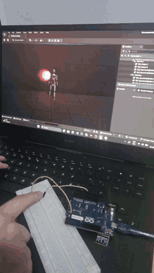
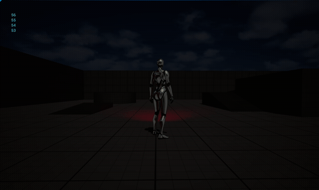
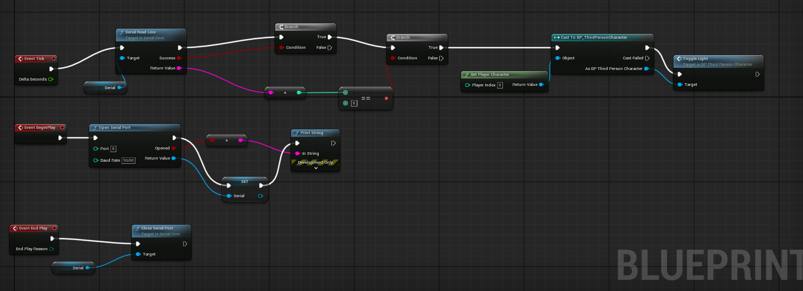
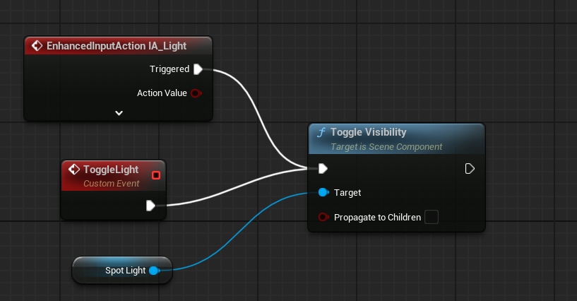

# Candy Sensors: Conexión Arduino ↔ Unreal Engine

> Prototipo de comunicación serial entre Arduino y Unreal Engine 5.5 usando el plugin **SerialCOM** y Blueprints.

   

<p align="center">
  
</p>

## Descripción

Este repositorio reúne las primeras pruebas de conexión entre una placa Arduino y un proyecto de Unreal Engine. El objetivo es que el hardware físico (botones, sensores, etc.) pueda enviar datos al motor y controlar elementos del juego en tiempo real.

Es un **prototipo en desarrollo**. Las pruebas son simples y sirven para validar la comunicación antes de construir mecánicas más complejas. Lo iré ampliando con el tiempo.

## Cómo funciona

```
[Arduino] --(USB / puerto serial, 9600 baudios)--> [Plugin SerialCOM] --> [Blueprint "Conexion"] --> [Personaje]
```

1. El Arduino envía mensajes de texto por el puerto serial (`Serial.println`).
2. En Unreal, el Blueprint **`Conexion`** (actor colocado en el nivel) abre el puerto al iniciar el juego (`Event BeginPlay → Open Serial Port`).
3. En cada frame (`Event Tick`) se lee una línea (`Serial Read Line`) y, según el valor recibido, se ejecuta una acción en el juego.
4. Al terminar el juego se cierra el puerto (`Event End Play → Close Serial Port`).

## Pruebas realizadas

### Prueba 1: Contador ✅

El primer paso fue comprobar que los datos llegaban a Unreal. El Arduino envía un número que aumenta cada 500 ms, y Unreal lo muestra en pantalla con `Print String`.

<p align="center">
  
</p>

📄 Código: [`Arduino/01_contador/01_contador.ino`](Arduino/01_contador/01_contador.ino)

### Prueba 2: Botón → encender/apagar una linterna ✅

Con la conexión funcionando, el siguiente paso fue controlar algo dentro del juego. Un botón conectado al **pin 2** (con `INPUT_PULLUP`) envía el valor `5` cada vez que se presiona. En Unreal, cuando el mensaje recibido es `5`, se obtiene el personaje del jugador, se hace *cast* a `BP_ThirdPersonCharacter` y se llama al evento **ToggleLight**, que enciende o apaga la linterna (*Spot Light*) del personaje.

📄 Código: [`Arduino/02_boton/02_boton.ino`](Arduino/02_boton/02_boton.ino)

**Blueprint `Conexion`:** apertura del puerto, lectura y cierre.



**Blueprint `BP_ThirdPersonCharacter`:** la linterna se puede activar con el botón físico (evento `ToggleLight`) o con el teclado (acción `IA_Light`).



## Requisitos

**Hardware**
- Arduino Uno + cable USB
- Protoboard, pulsador y cables (para la prueba 2)

**Software**
- Windows (el plugin SerialCOM solo funciona en Win64)
- Unreal Engine 5.5
- Plugin [SerialCOM](https://github.com/videofeedback/Unreal_Engine_SerialCOM_Plugin) de Ramiro Montes De Oca (ya incluido en `Plugins/`)
- Arduino IDE

## Cómo probarlo

1. Sube el sketch que quieras probar al Arduino desde Arduino IDE.
2. Revisa en qué puerto COM está conectado el Arduino (*Herramientas → Puerto*).
3. **Cierra el Monitor Serie de Arduino IDE**, porque el puerto solo puede estar abierto en un programa a la vez.
4. Abre `ConexionArduino.uproject`. Si te pide compilar los módulos, acepta.
5. En el Blueprint `Content/ThirdPerson/Blueprints/Conexion`, en el nodo `Open Serial Port`, configura el mismo número de puerto (ej. `5` para COM5) y `9600` de baud rate.
6. Presiona **Play**. En pantalla debería aparecer `true` si el puerto se abrió correctamente.
7. Presiona el botón físico y la linterna del personaje debería encenderse o apagarse.

### Conexión del botón

| Botón   | Arduino |
|---------|---------|
| Pata 1  | Pin 2   |
| Pata 2  | GND     |

No necesita resistencia externa porque se usa la resistencia interna del Arduino (`INPUT_PULLUP`).

## Estructura del repositorio

```
├── Arduino/
│   ├── 01_contador/          # Prueba 1: envío de números
│   └── 02_boton/             # Prueba 2: botón → linterna
├── Config/
├── Content/
│   └── ThirdPerson/
│       ├── Blueprints/       # Conexion y BP_ThirdPersonCharacter
│       └── Input/Actions/    # IA_Light
├── Plugins/SerialCOM/        # Plugin de comunicación serial
├── Source/                   # Código C++ base del proyecto
├── docs/img/                 # Capturas y GIFs de la documentación
└── ConexionArduino.uproject
```

## Próximos pasos

- [ ] Agregar más sensores y entradas
- [ ] Definir un formato de mensajes más claro entre Arduino y Unreal
- [ ] Mejorar la lectura de datos (sin depender de cada frame del `Tick`)
- [ ] Integrar la conexión en una mecánica de juego

## Créditos

- Plugin SerialCOM: [Ramiro Montes De Oca](https://github.com/videofeedback/Unreal_Engine_SerialCOM_Plugin), basado en UE4Duino.
- Personaje y nivel: plantilla Third Person de Unreal Engine.

## Autora

**Kristal Espinoza**, estudiante de Ingeniería en Realidad Virtual y Diseño de Juegos Digitales.
GitHub: [@Latshir110](https://github.com/Latshir110)
